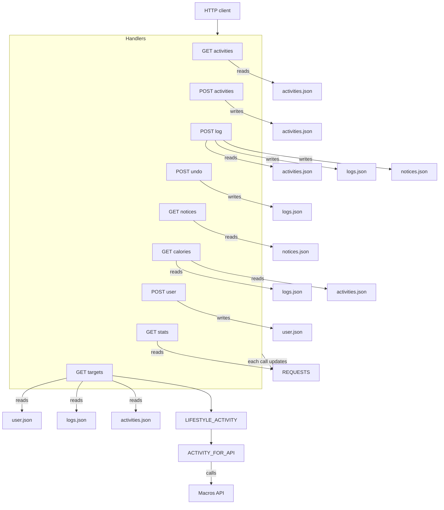

# architecure_design_patterns_python

A small calorie app for the architecture and design-patterns labs. One Python file stores activities, workout logs, and a user profile in local JSON files, then asks a public macros service for daily diet targets.

## What you can achieve

The app calculates calories from an activity and how long you do it. A session of running, walking, or any other saved activity becomes a number of calories burned, and those sessions can be added up for the last day, week, or month.

That is enough for a few real uses:

- Check how many calories a workout burns before or after you do it.
- Keep a log of sessions, drop the last one if it was entered by mistake, and see whether the week has passed a 500 kcal exercise notice.
- Add a sport that is not in the starter list, with its own calories per hour.
- Save age, gender, weight, height, and a goal to lose, maintain, or gain weight.
- Turn that profile and the recent workouts into daily targets for calories, protein, carbohydrates, and fat.

Together, this is a small activity log that connects what you did with what you might eat.

## Current architecture

This is the as-is picture. Update it when a refactor moves a responsibility out of `app.py`.



## What it does

Ten activities in `data/activities.json` each have calories burned per 60 minutes. A logged session stores the activity name, the minutes, and the time in `data/logs.json`. Burned calories are `round(calories_per_60_min * minutes / 60)` and are calculated when needed, not stored on the log.

`data/user.json` holds one profile: age, gender, weight, height, and a goal of `lose`, `maintain`, or `gain`. Saving again replaces that profile.

`GET /targets` sums the calories burned in the requested period and scales that total to a week (a day is multiplied by 7, a month by 7/30). It compares the weekly total with `LIFESTYLE_ACTIVITY` in `app.py` and picks the highest lifestyle whose minimum the user has reached. That level is sent to the public macros calculator, which returns daily calories, protein, carbohydrates, and fat.

| Lifestyle in this app | Value sent to the calculator |
|---|---|
| not active | sedentary |
| little activity | lightly_active |
| moderate | moderately_active |
| active | very_active |
| very active | extra_active |

The sample sessions in `data/logs.json` are dated around 10 October 2026. A short workout week stays under every lifestyle minimum, so the diet call uses `not active`.

## Setup

Use Python 3.9 or newer. Run these commands from the project root. The JSON paths are relative to that directory.

```powershell
py -3 -m venv .venv
.\.venv\Scripts\Activate.ps1
python -m pip install -r requirements.txt
python app.py
```

`requirements.txt` installs Flask, which runs the app, and Ruff, which checks and formats the Python files. The app listens on `http://127.0.0.1:5000`. On macOS, port 5000 is sometimes taken by AirPlay. If startup fails, change the port at the bottom of `app.py`.

In Cursor or VS Code, saving a Python file formats it and applies Ruff fixes. That behavior comes from `.vscode/settings.json`. Install the Ruff extension (`charliermarsh.ruff`) if the editor does not format on save. The rules are in `pyproject.toml`: line length 88, and the `E`, `F`, and `I` checks. `test_e2e.py` is allowed to import `app` after it changes directory.

From the activated virtual environment you can run the same checks by hand:

```powershell
ruff check .
ruff format .
```

## Requests

Save a profile:

```powershell
Invoke-RestMethod -Method Post -Uri "http://127.0.0.1:5000/user?age=28&gender=male&weight_kg=80&height_cm=178&goal=maintain"
```

List activities:

```powershell
Invoke-RestMethod -Uri "http://127.0.0.1:5000/activities"
```

Add an activity:

```powershell
Invoke-RestMethod -Method Post -Uri "http://127.0.0.1:5000/activities" -ContentType "application/json" -Body '{"name":"boxing","calories_per_60_min":540}'
```

Log a session:

```powershell
Invoke-RestMethod -Method Post -Uri "http://127.0.0.1:5000/log" -ContentType "application/json" -Body '{"type":"running","minutes":30}'
```

Read notices:

```powershell
Invoke-RestMethod -Uri "http://127.0.0.1:5000/notices"
```

Undo the last log:

```powershell
Invoke-RestMethod -Method Post -Uri "http://127.0.0.1:5000/log/undo"
```

Calories burned in the last day, week, or month:

```powershell
Invoke-RestMethod -Uri "http://127.0.0.1:5000/calories?period=day"
```

```powershell
Invoke-RestMethod -Uri "http://127.0.0.1:5000/calories?period=week"
```

```powershell
Invoke-RestMethod -Uri "http://127.0.0.1:5000/calories?period=month"
```

Daily diet targets for the same periods. A profile must already be saved.

```powershell
Invoke-RestMethod -Uri "http://127.0.0.1:5000/targets?period=day"
```

```powershell
Invoke-RestMethod -Uri "http://127.0.0.1:5000/targets?period=week"
```

```powershell
Invoke-RestMethod -Uri "http://127.0.0.1:5000/targets?period=month"
```

Request counter:

```powershell
Invoke-RestMethod -Uri "http://127.0.0.1:5000/stats"
```

## Test

The end-to-end test calls every endpoint, including invalid input, calorie windows, notices, undo, and diet targets from the live macros service. It restores the sample JSON files afterward.

```powershell
.\.venv\Scripts\Activate.ps1
python -m unittest test_e2e.py -v
```
